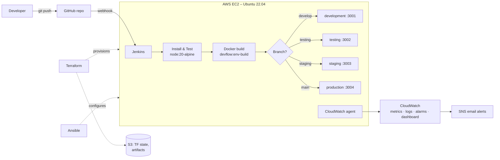

# DevFlow

**Multi-environment CI/CD pipeline for automated application deployment**

DevFlow automates the full path from `git push` to a running, monitored application. The Git branch you push to
decides which environment receives the deployment: no manual environment selection, no configuration drift.

```
Git Push → Jenkins CI/CD → Automated Tests → Docker Build → Branch Detection → Deploy → Health Check → CloudWatch
```

Academic project, Cloud & DevOps Engineering elective.

| Team member | Reg. no. |
|---|---|
| Atharva Bhutada | RA2311026010089 |
| Shashwat Sharma | RA2311026010121 |
| Prajjwal Rawat | RA2311026010224 |

---

## Contents

- [Problem and solution](#problem-and-solution)
- [Architecture](#architecture)
- [Branch → environment mapping](#branch--environment-mapping)
- [Technology stack](#technology-stack)
- [Repository layout](#repository-layout)
- [Components](#components)
  - [Sample application](#1-sample-application-app)
  - [Infrastructure – Terraform](#2-infrastructure--terraform-terraform)
  - [Server configuration – Ansible](#3-server-configuration--ansible-ansible)
  - [CI/CD pipeline – Jenkins](#4-cicd-pipeline--jenkins-jenkinsfile)
  - [Monitoring – CloudWatch](#5-monitoring--cloudwatch)
- [Deployment guide](#deployment-guide)
- [Project status](#project-status)
- [Cost and clean-up](#cost-and-clean-up)
- [Future enhancements](#future-enhancements)

---

## Problem and solution

Manual deployments are slow and error-prone. Configuration drifts between environments, testing and production
run different versions, and rollbacks are hard to do reliably.

DevFlow replaces `build → test → copy to server → restart`, done by hand, with a pipeline triggered by every push:

- **Infrastructure as code:** Terraform creates every AWS resource.
- **Configuration as code:** Ansible installs and configures everything on the server.
- **Pipeline as code:** the `Jenkinsfile` builds, tests, containerises, deploys and health-checks.
- **Isolation:** every environment runs in its own Docker container on its own port.
- **Observability:** CloudWatch collects metrics and logs, shows them on a dashboard and emails alerts.

---

## Architecture



All four environments run as isolated Docker containers on one EC2 instance. Terraform provisions the instance and
Ansible configures it.

---

## Branch → environment mapping

| Git branch | Environment | Host port | Purpose |
|---|---|---|---|
| `develop` | development | 3001 | Feature integration and early testing |
| `testing` | testing | 3002 | Functional and automated testing |
| `staging` | staging | 3003 | Pre-production validation |
| `main` | production | 3004 | Live, stable application |
| any other (e.g. `feature/*`) | – | – | Built and tested only, never deployed |

Promotion flow: `feature/*` → `develop` → `testing` → `staging` → `main`.

The mapping is defined in three places, which must stay in sync: `Jenkinsfile` (`ENVIRONMENTS`),
`ansible/group_vars/all.yml` (`environments`) and `terraform/variables.tf` (`app_ports`).

---

## Technology stack

| Area | Tool |
|---|---|
| Cloud | AWS – EC2, S3, IAM, CloudWatch, SNS |
| Infrastructure as code | Terraform ≥ 1.10 (AWS provider 5.x) |
| Configuration management | Ansible (tested with ansible-core 2.16) |
| CI/CD | Jenkins LTS (Multibranch Pipeline) |
| Containers | Docker Engine |
| Application | Node.js 20, Express 4, Jest + Supertest |
| Version control | Git, GitHub |
| OS | Ubuntu 22.04 LTS |

---

## Repository layout

```
.
├── app/                       Sample Node.js application
│   ├── src/app.js             Express app: / and /health
│   ├── src/server.js          Entry point (reads PORT, APP_ENV)
│   ├── tests/app.test.js      Jest + Supertest tests
│   ├── Dockerfile             node:20-alpine, non-root, HEALTHCHECK
│   └── package.json
├── terraform/
│   ├── bootstrap/main.tf      One-time S3 bucket for remote state
│   ├── versions.tf            Providers + S3 backend
│   ├── variables.tf
│   ├── main.tf                EC2, EIP, security group, IAM, S3 artifacts bucket
│   ├── cloudwatch.tf          Alarms, SNS, log groups, dashboard
│   ├── outputs.tf
│   ├── backend.hcl.example
│   └── terraform.tfvars.example
├── ansible/
│   ├── site.yml               Main playbook
│   ├── group_vars/all.yml     Environments, ports, versions
│   ├── inventory.ini.example  (real inventory.ini is generated by Terraform)
│   └── roles/
│       ├── common/            Packages, timezone, swap
│       ├── docker/            Docker Engine + log rotation
│       ├── jenkins/           Java 17 + Jenkins LTS
│       ├── cloudwatch/        CloudWatch agent + config template
│       └── app_env/           /opt/devflow/<env>.env files
├── Jenkinsfile                The pipeline
├── docs/jenkins-setup.md      Jenkins job + GitHub webhook setup
├── .gitattributes             Forces LF line endings (scripts run on Linux)
└── .gitignore                 Excludes state, tfvars, inventory, node_modules
```

---

## Components

### 1. Sample application (`app/`)

A small Express app whose only job is to make deployments visible.

| Route | Response |
|---|---|
| `GET /` | HTML page showing the **environment name**, version and Jenkins build number |
| `GET /health` | `{"status":"UP","environment":"...","version":"1.0.0","build":"12","uptimeSeconds":42}` |

- Configured through environment variables: `PORT` (default `3000`), `APP_ENV`, `BUILD_NUMBER`.
- Three Jest tests cover `/health`, `/` and the 404 handler, with 100% coverage.
- The Docker image uses `node:20-alpine`, installs production dependencies only, runs as the non-root `node` user
  and has a built-in `HEALTHCHECK` on `/health`.

Run locally:

```bash
cd app
npm install
npm test
npm start            # http://localhost:3000
```

Run in Docker:

```bash
docker build -t devflow:local app
docker run -d -p 3001:3000 -e APP_ENV=development --name devflow-development devflow:local
curl http://localhost:3001/health
```

### 2. Infrastructure – Terraform (`terraform/`)

**Bootstrap** (`terraform/bootstrap/`, run once): creates the S3 bucket that stores Terraform state. The bucket is
versioned, AES-256 encrypted and blocks all public access. The bootstrap config keeps its own state locally.

**Main stack** (state stored in S3 with native lock files):

| Resource | Details |
|---|---|
| EC2 instance | Ubuntu 22.04 (latest Canonical AMI), `t3.small`, 20 GB encrypted gp3, IMDSv2 required |
| Elastic IP | Fixed public IP, so the GitHub webhook URL survives stop/start |
| Security group | SSH `22` from `admin_cidr` only · Jenkins `8080` · app ports `3001–3004` |
| IAM role + instance profile | `CloudWatchAgentServerPolicy` + read/write on the artifacts bucket. No access keys are stored on the server. |
| S3 artifacts bucket | `devflow-artifacts-<account-id>`, private, versioned, old versions expire after 30 days |
| Key pair | From `~/.ssh/id_ed25519.pub` |
| `ansible/inventory.ini` | Generated with the Elastic IP, SSH user/key, bucket name and region |

**Inputs** (`terraform.tfvars`): `admin_cidr` (required), `alert_email`, `aws_region` (default `ap-south-1`),
`instance_type`, `root_volume_size`, alarm thresholds.

**Outputs:** `public_ip`, `ssh_command`, `jenkins_url`, `github_webhook_url`, `app_urls`, `artifacts_bucket`,
`cloudwatch_dashboard_url`.

### 3. Server configuration – Ansible (`ansible/`)

`site.yml` applies five roles to the `devflow` host. The playbook is idempotent: re-running it only changes what has
drifted.

| Role | What it does |
|---|---|
| `common` | git, curl, unzip, jq, timezone (`Asia/Kolkata`), **2 GB swap** so Jenkins and 4 containers fit in 2 GB RAM |
| `docker` | Docker Engine, Buildx and Compose from Docker's apt repo. Container logs capped at 3 × 10 MB. `ubuntu` user added to the `docker` group. |
| `jenkins` | OpenJDK 17 and Jenkins LTS. `jenkins` user added to the `docker` group. Waits for Jenkins to start, then prints the initial admin password. |
| `cloudwatch` | Installs the CloudWatch agent and templates its config: CPU, memory, swap and disk metrics (namespace `DevFlow`, aggregated by `InstanceId`); ships `/var/log/syslog` and Docker container logs |
| `app_env` | Writes `/opt/devflow/{development,testing,staging,production}.env` with `APP_ENV`, `PORT`, `HOST_PORT` and `GIT_BRANCH` |

Ansible does not run natively on Windows; use WSL (Ubuntu). See [ansible/README.md](ansible/README.md).

### 4. CI/CD pipeline – Jenkins (`Jenkinsfile`)

A declarative pipeline run by a **Multibranch Pipeline** job and triggered by a GitHub webhook.

| # | Stage | What happens |
|---|---|---|
| 1 | Resolve Environment | Maps `BRANCH_NAME` to an environment and port and names the build, e.g. `#12 develop -> development` |
| 2 | Install & Test | `npm ci` and `npm test` inside a `node:20-alpine` container; the coverage report is archived |
| 3 | Build Docker Image | `docker build` tagged `devflow:<env>-<build>`, with the build number baked in |
| 4 | Deploy | Records the currently running image, replaces container `devflow-<env>` using `/opt/devflow/<env>.env`, `--restart unless-stopped` |
| 5 | Health Check | Calls `curl /health` up to 10 times. **On failure, it automatically restarts the previous image** and fails the build. |
| – | Post | Keeps the 3 newest images per environment for manual rollback and prunes dangling images |

Safety properties:

- A failed test or build stops the pipeline **before** deployment, so live environments are never touched.
- Builds of the same branch never run concurrently. Each build has a 20-minute timeout.
- Branches outside the mapping are tested and built but never deployed.

Jenkins job and webhook setup: [docs/jenkins-setup.md](docs/jenkins-setup.md).

### 5. Monitoring – CloudWatch

Defined in `terraform/cloudwatch.tf`. The metrics come from the agent installed by Ansible.

**Alarms**, each notifying the `devflow-alerts` SNS topic when it triggers and when it recovers:

| Alarm | Condition |
|---|---|
| `devflow-cpu-high` | CPU > 80% for 10 min |
| `devflow-memory-high` | Memory > 85% for 10 min |
| `devflow-disk-high` | Root disk > 85% |
| `devflow-status-check-failed` | EC2 instance or system status check failing |

**Logs:** `/devflow/system` (syslog) and `/devflow/containers` (all app containers), each kept for 14 days. A metric
filter counts error lines (`Error`, `ERROR`, `error`, `Exception`) as `DevFlow/ContainerErrors`.

**Dashboard `devflow`:** links to all 4 environments and Jenkins; charts for CPU, memory/swap, disk usage (gauge),
network and container error count; alarm status; and the 50 latest container log lines.

---

## Deployment guide

### Prerequisites

- An AWS account with a billing budget/alert set up
- An IAM user with `AmazonEC2FullAccess`, `IAMFullAccess`, `AmazonS3FullAccess`, `CloudWatchFullAccess` and
  `AmazonSNSFullAccess`, configured with `aws configure` (region `ap-south-1`)
- Terraform ≥ 1.10 (`winget install Hashicorp.Terraform`), AWS CLI v2
- WSL Ubuntu with Ansible (`sudo apt install ansible`)
- SSH key pair at `~/.ssh/id_ed25519`

### 1. Create the state bucket (once)

```bash
cd terraform/bootstrap
terraform init
terraform apply -var="state_bucket_name=devflow-tfstate-<unique-suffix>"
```

### 2. Provision AWS

```bash
cd terraform
cp backend.hcl.example backend.hcl            # set bucket name
cp terraform.tfvars.example terraform.tfvars  # set admin_cidr, alert_email
terraform init -backend-config=backend.hcl
terraform plan
terraform apply
```

Then confirm the SNS subscription email that AWS sends.

### 3. Configure the server (WSL)

```bash
mkdir -p ~/.ssh && cp /mnt/c/Users/<you>/.ssh/id_ed25519* ~/.ssh/ && chmod 600 ~/.ssh/id_ed25519
cd ansible
ansible-galaxy collection install -r requirements.yml
ANSIBLE_HOST_KEY_CHECKING=False ansible devflow -i inventory.ini -m ping
ANSIBLE_HOST_KEY_CHECKING=False ansible-playbook -i inventory.ini site.yml
```

### 4. Set up Jenkins

Follow [docs/jenkins-setup.md](docs/jenkins-setup.md): setup wizard, Docker Pipeline plugin, the `DevFlow`
Multibranch Pipeline job and the GitHub webhook.

### 5. Deploy and promote

Push to `develop` and check that `http://<ip>:3001` shows *Environment: development*. Then merge
`develop → testing → staging → main` to deploy to ports 3002, 3003 and 3004.

---

## Project status

| Phase | Work | Status | Where |
|---|---|---|---|
| 0 | Repo, branches (`main`, `develop`, `testing`, `staging`), LF line endings | ✅ Done | `develop` |
| 1 | Sample app, tests, Dockerfile | ✅ Done, tests passing | `develop` |
| 2 | Terraform infrastructure | ✅ Written, `terraform validate` passes | `feature/terraform` – [PR #1](https://github.com/Shash309/DevFlow/pull/1) |
| 3 | Ansible playbook | ✅ Written, `--syntax-check` passes | `feature/ansible` |
| 4 | Jenkinsfile + setup docs | ✅ Written | `feature/jenkins` |
| 5 | CloudWatch alarms, dashboard, SNS | ✅ Written, `terraform validate` passes | `feature/terraform` (+ agent config on `feature/ansible`) |
| 6 | Apply to AWS, end-to-end demo | ⏳ Pending AWS credentials | – |

Not yet verified: `terraform apply` against AWS, an Ansible run on a real host, the pipeline in a running Jenkins,
and the Docker image build (only tested via `npm test`).

---

## Cost and clean-up

`t3.small` is **not** in the free tier. It costs about USD 0.02 per hour in `ap-south-1`, plus a small charge for the
Elastic IP and a few cents for S3 and CloudWatch.

- Between work sessions, stop the instance from the EC2 console. The Elastic IP keeps the same address.
- After the project is graded, run `terraform destroy` in `terraform/`. Then empty the versioned state bucket in the
  S3 console and run `terraform destroy` in `terraform/bootstrap/`.

---

## Future enhancements

Not part of the current implementation:

- Blue-green and canary deployments
- Kubernetes (k3s / Minikube) orchestration
- Automated security scanning (e.g. Trivy, npm audit)
- Slack / Discord deployment notifications
- Image registry (Amazon ECR) instead of local images
- Auto-scaling and multi-cloud deployment
- Automated performance testing
